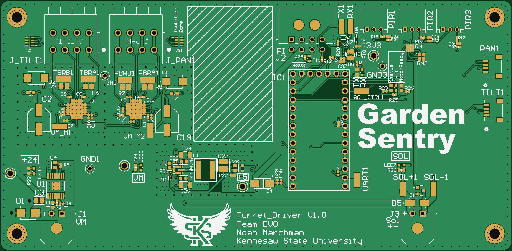
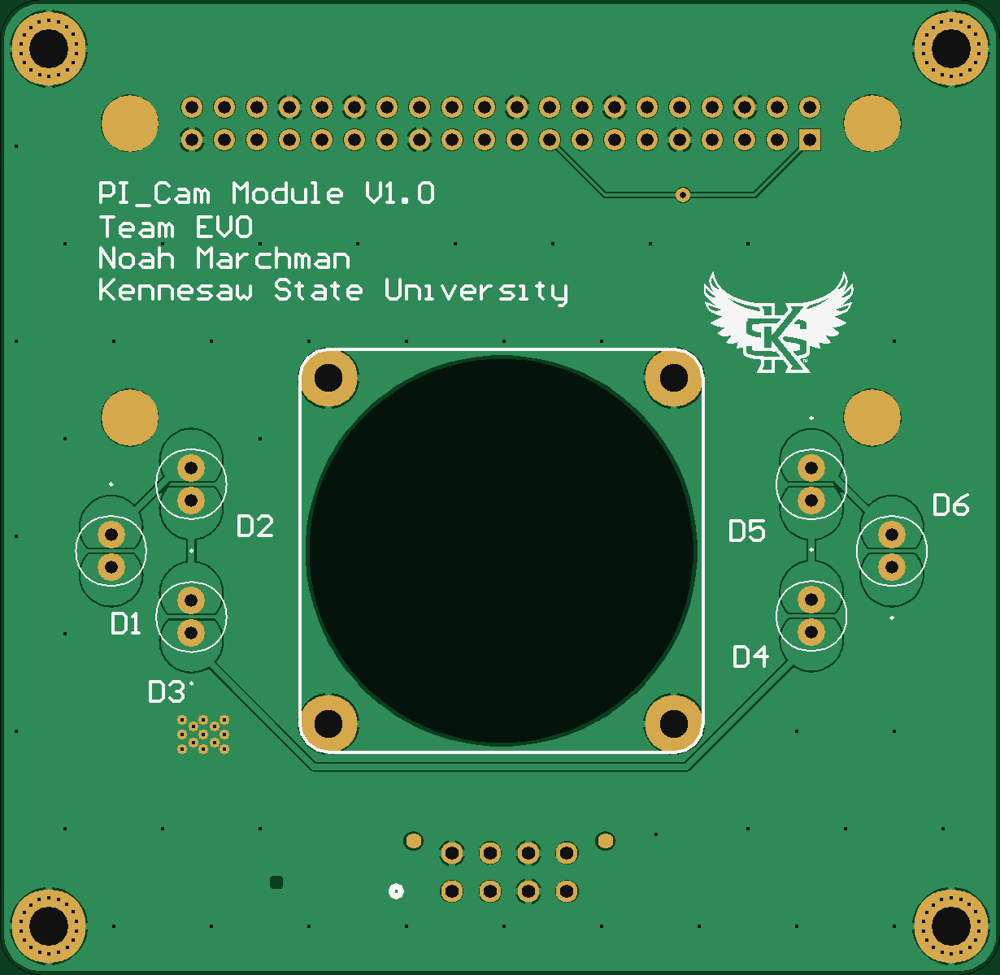
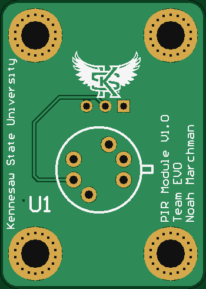

# Hardware

Custom PCBs for one Garden Sentry sprayer unit, designed in Altium Designer. Rev V1 has been sent for fabrication.

| Board | Purpose | Layers | Size |
|---|---|---|---|
| [Turret_Driver](Turret_Driver/) | Main board: power, Teensy 4.0, two stepper drivers, solenoid driver | 4 | 5.90 × 2.90 in |
| [PI_Board](PI_Board/) | Pi Zero 2 W carrier with the 850 nm IR illuminator around the camera | 2 | 3.08 × 3.00 in |
| [PIR_Board](PIR_Board/) | BS612 PIR motion sensor that wakes the unit | 2 | 0.88 × 1.23 in |

## System block diagram

```
          24 V wall supply
                 │
     ┌───────────▼────────────────────────────────────┐
     │ Turret_Driver                                  │
     │  TPS26600 eFuse ─► 24 V VM ─► 2× TMC2209 ─────►│── Pan / tilt NEMA 17 steppers
     │                 └► LMR33630 buck ─► 5 V / 3.3 V│
     │  Teensy 4.0 ── single UART bus ── TMC2209 ×2   │
     │  Low-side MOSFET ─────────────────────────────►│── 24 V water solenoid
     │  3× PIR inputs, 2× position-sensor ports       │
     └──────────┬─────────────────────────────────────┘
                │ 8-pin Molex Micro-Fit (power + UART)
     ┌──────────▼───────────┐        ┌───────────┐
     │ PI_Board             │        │ PIR_Board │──► Turret_Driver PIR input
     │ Pi Zero 2 W + camera │        └───────────┘
     │ 6× SFH 4554 IR LEDs  │
     └──────────────────────┘
```

## Turret_Driver (main board)



- **Input protection:** TPS26600 eFuse plus SMBJ33CA TVS on the 24 V input; per-motor fuses and TVS diodes on VM
- **Power:** LMR33630 synchronous buck (3 A) for the 5 V rail, with a 3.3 V rail for logic
- **Motion:** two TMC2209 stepper drivers in UART mode, both on one shared Teensy UART (addressed). Motors land on WAGO lever terminal blocks
- **Actuation:** IRLML6344 low-side switch with Schottky flyback for the 24 V solenoid valve
- **Interfaces:** 8-pin link to the Pi board, three JST-PH PIR inputs, two JST-SH 4-pin ports for the pan/tilt magnetic position sensors
- **Debug:** status, fault, and TX/RX LEDs, plus labeled test points on every rail and motor phase
- 4-layer stackup (top, bottom, one internal signal layer, one internal plane), with a copper-free isolation zone separating the motor-power section from the logic section

Files: [schematic PDF](Turret_Driver/Main_V1_Schematic.pdf) · [BOM](Turret_Driver/Turret_Driver_BOM.xlsx) · [gerbers](Turret_Driver/Fabrication/Main_V1_Gerbers.zip) · [bottom view](images/Main_V1_bottom.png)

## PI_Board



- Pi Zero 2 W mounts on a 2×20 socket, with the IMX462 IR-cut camera centered in the board
- Six OSRAM SFH 4554 850 nm IR LEDs ring the camera, switched by an IRLML0060 MOSFET from a Pi GPIO
- 8-pin Molex link back to the main board for power and UART

Files: [schematic PDF](PI_Board/PI_V1_Schematic.pdf) · [BOM](PI_Board/PI_BOM.xlsx) · [gerbers](PI_Board/Fabrication/PI_V1_Gerbers.zip) · [bottom view](images/PI_V1_bottom.png)

## PIR_Board



- BS612 PIR sensor with a trimmer for sensitivity adjustment
- 3-pin JST-PH cable to the main board

Files: [schematic PDF](PIR_Board/PIR_V1_Schematic.pdf) · [BOM](PIR_Board/PIR_BOM.xlsx) · [gerbers](PIR_Board/Fabrication/PIR_V1_Gerbers.zip) · [bottom view](images/PIR_V1_bottom.png)

## Repository layout

```
Hardware/
├── Turret_Driver/   Altium project (.PrjPcb, .SchDoc, .PcbDoc), schematic PDF, BOM, Fabrication/ gerbers
├── PI_Board/        same structure
├── PIR_Board/       same structure
└── images/          Top/bottom renders generated from the fabrication gerbers
```

Open any `.PrjPcb` in Altium Designer to view the full schematic and layout.
