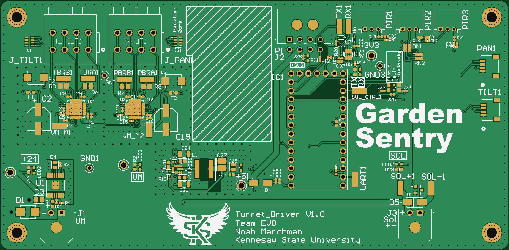

# Senior-Design
Garden Sentry: a senior design project that detects deer and small animals with a camera and sprays water to drive them off. A central Raspberry Pi 5 runs the image recognition. Each sprayer unit has a Pi Zero 2 W, an IR night-vision camera, a PIR wake sensor, and a Teensy 4.0 that drives a pan/tilt turret with TMC2209 steppers.

## Repository contents

| Folder | Contents |
|---|---|
| [Hardware/](Hardware/) | Altium PCB projects for the turret main board, Pi camera/IR board, and PIR wake board, with schematics, BOMs, gerbers, and board renders |
| [Docs/](Docs/) | [Design decisions](Docs/Design_Decisions.md): key engineering choices and trade-offs |
| [Mechanical/](Mechanical/) | SolidWorks models of the pan/tilt turret, sensor mounts, and test base |
| [TestCode/](TestCode/) | Bring-up and test firmware (Teensy 4.0, PlatformIO) |

